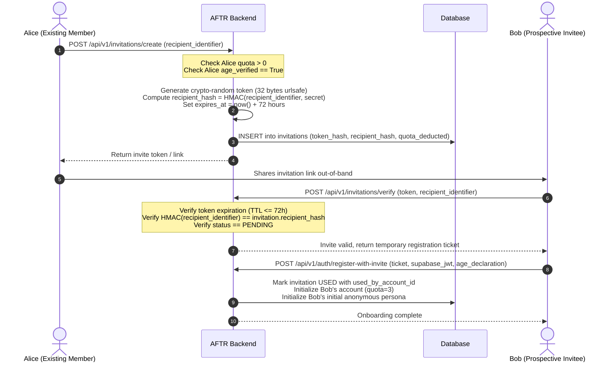
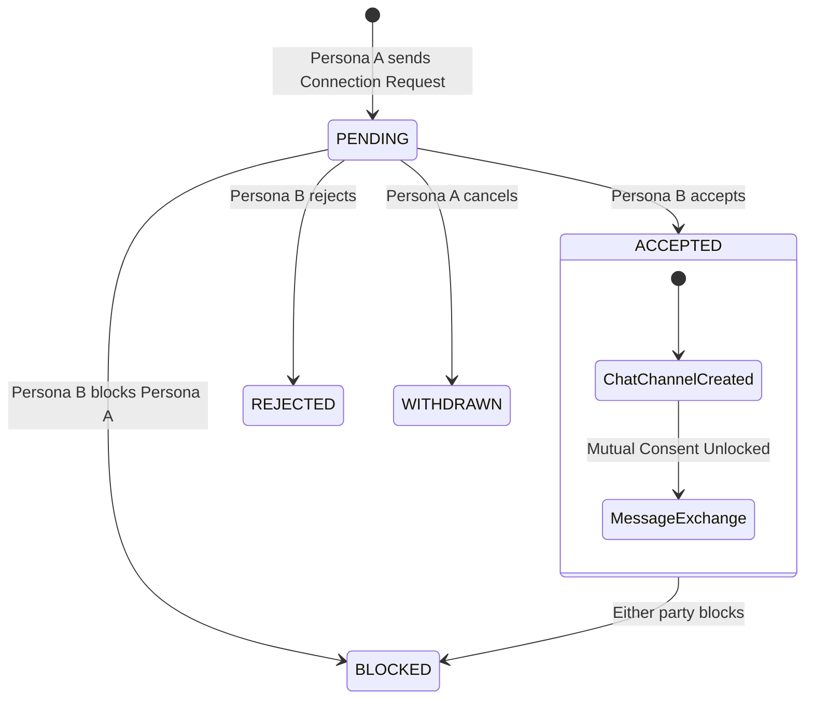

# AFTR — System Architecture

## 1. System Overview & Principles

AFTR is designed as a **modular monolith** backend built on FastAPI and PostgreSQL, paired with a Next.js (App Router) frontend. It provides a secure, anonymous environment for adult (18+) campus communities.

### Key Architectural Tenets
1. **Zero-Leakage Identity Separation**: Authentication identifiers (Supabase UUID, email, IP logs, credentials) are strictly partitioned from social personas (pseudonyms, avatars, confessions, comments, messages).
2. **Cryptographic & Bound Invitations**: Access is strictly invite-only. Every invitation is single-use, expires in 72 hours, and is bound to the intended recipient to prevent unauthorized propagation or link harvesting.
3. **No Campus Surveillance Verification**: College emails (.edu / ac.in) and student ID verification are forbidden by product policy. Campus affiliation is optional and strictly self-declared.
4. **Mandatory Age Assurance**: Access to adult-oriented features requires explicit age assurance (18+ verification) enforced server-side before persona creation.
5. **Consent-Gated Private Messaging**: Private direct messaging is mathematically impossible without prior mutual consent (Connection Request state machine).
6. **No High-Risk MVP Media**: Explicit image uploads and real-time live location tracking are prohibited in the MVP schema to minimize revenge porn, non-consensual imagery, and stalking vectors.

---

## 2. Decoupled Data Model: Identity vs. Persona

```
+-------------------------------------------------------+
|                 IDENTITY DOMAIN                       |
|  (Protected, Non-Public, Never Exposed via Social API)|
+-------------------------------------------------------+
|  `accounts`                                           |
|  - id: UUID (PK)                                      |
|  - supabase_user_id: UUID (Unique, Indexed)           |
|  - email_hash: VARCHAR(64) (Salted SHA-256 for lookup)|
|  - is_age_verified: BOOLEAN (Mandatory 18+)           |
|  - birth_year: INT (Optional age band)                |
|  - invite_quota: INT (Default 3 upon qualification)   |
|  - invited_by_account_id: UUID (Nullable)             |
|  - status: ENUM (ACTIVE, SUSPENDED, BANNED)           |
|  - created_at: TIMESTAMPTZ (UTC)                      |
+-------------------------------------------------------+
                           |
                           | 1-to-Many (or 1-to-1 active)
                           v
+-------------------------------------------------------+
|                 SOCIAL PERSONA DOMAIN                 |
|      (Public Anonymous Identity, Ephemeral/Decoupled)  |
+-------------------------------------------------------+
|  `personas`                                           |
|  - id: UUID (PK)                                      |
|  - account_id: UUID (FK -> accounts.id, Internal Only)|
|  - display_name: VARCHAR(50) (Generated/Custom Anon)  |
|  - avatar_seed: VARCHAR(100) (Abstract SVG identifier)|
|  - bio: TEXT (Optional)                               |
|  - declared_campus: VARCHAR(100) (Optional)           |
|  - adult_interests: TEXT[] / JSONB                    |
|  - is_active: BOOLEAN                                 |
|  - created_at: TIMESTAMPTZ (UTC)                      |
+-------------------------------------------------------+
                           |
        +------------------+------------------+
        |                                     |
        v                                     v
+-----------------------+           +-----------------------+
|     `confessions`     |           |     `connections`     |
| - id: UUID (PK)       |           | - id: UUID (PK)       |
| - persona_id: UUID    |           | - sender_persona_id   |
| - content: TEXT       |           | - recipient_persona_id|
| - tag: VARCHAR        |           | - status: ENUM        |
| - is_sensitive: BOOL  |           |   (PENDING, ACCEPTED, |
| - view_count: INT     |           |    REJECTED, BLOCKED) |
+-----------------------+           +-----------------------+
```

### Critical API Boundary
- Client-facing social responses (feeds, confessions, comments, stories, events, messages) **only serialize `persona_id`, `display_name`, and `avatar_seed`**.
- Under no circumstance is `account_id`, `supabase_user_id`, or any identifying hash included in serialized JSON schemas for social endpoints.

---

## 3. Invitation System Architecture



---

## 4. Connection Requests & Consent-Gated Messaging



### Messaging Security Rule
- `messages` table enforces foreign key on `conversation_id`.
- Every `conversation` requires a corresponding `connection` with status `ACCEPTED`.
- A database constraint or FastAPI middleware ensures that any attempt by a user to write or read a message in a conversation where the connection is not `ACCEPTED` immediately returns HTTP 403 Forbidden.

---

## 5. Moderation & Safety Pipeline

1. **Pre-Ingestion Keyword & Pattern Filter**: High-risk patterns (doxxing: phone numbers, student ID regexes; CSAM/violence keywords) trigger immediate rejection with a safety advisory.
2. **User Reporting & Flag Thresholds**: Any user can report a confession, comment, or persona. Configurable threshold (e.g., 3 unique reports) triggers automated shadow-suppression pending human moderator review.
3. **Audit Trail**: Moderation actions (warning, strike, persona shadowban, account suspension) are logged in an immutable `moderation_actions` table.

---

## 6. Directory Layout (Modular Monolith)

```
AFTR/
├── backend/
│   ├── app/
│   │   ├── api/
│   │   │   ├── v1/
│   │   │   │   ├── auth.py
│   │   │   │   ├── invitations.py
│   │   │   │   ├── personas.py
│   │   │   │   ├── confessions.py
│   │   │   │   ├── stories.py
│   │   │   │   ├── events.py
│   │   │   │   ├── connections.py
│   │   │   │   ├── messaging.py
│   │   │   │   ├── moderation.py
│   │   │   │   └── api_router.py
│   │   ├── core/
│   │   │   ├── config.py
│   │   │   ├── security.py
│   │   │   ├── database.py
│   │   │   └── exceptions.py
│   │   ├── models/            # SQLAlchemy 2.0 ORM models
│   │   │   ├── base.py
│   │   │   ├── account.py
│   │   │   ├── invitation.py
│   │   │   ├── persona.py
│   │   │   ├── confession.py
│   │   │   ├── story.py
│   │   │   ├── event.py
│   │   │   ├── connection.py
│   │   │   ├── message.py
│   │   │   └── moderation.py
│   │   ├── schemas/           # Pydantic v2 validation models
│   │   ├── services/          # Business logic services
│   │   └── main.py            # FastAPI ASGI entrypoint
│   ├── alembic/               # Database migrations
│   ├── tests/                 # Automated pytest suite
│   ├── pyproject.toml
│   └── Dockerfile
├── frontend/                  # Next.js App Router
│   ├── src/
│   │   ├── app/
│   │   ├── components/
│   │   ├── lib/
│   │   └── hooks/
│   ├── package.json
│   └── tailwind.config.ts
├── docs/                      # Architectural and operational documentation
│   ├── ARCHITECTURE.md
│   ├── SECURITY.md
│   └── IMPLEMENTATION_STATUS.md
├── docker-compose.yml
└── .env.example
```
