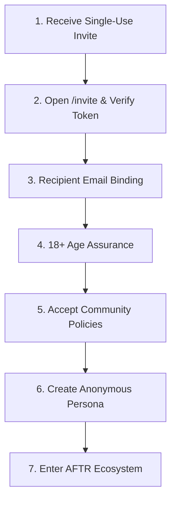

# AFTR — SRM Campus Closed Beta Onboarding Guide

> **Release**: Private Beta Candidate `v0.9.0-rc1`  
> **Target Group**: SRM Institute of Science and Technology (KTR Campus Community)  
> **Platform Status**: Closed, invitation-only, invite-gate enforced.

---

## 1. Welcome to the AFTR Private Beta

Thank you for participating in the closed private beta of **AFTR** (*"Meet without revealing"*). AFTR is an invitation-only, 18+ anonymous campus social and discovery platform designed to give students a secure, candid, and judgment-free space to connect.

### Essential Beta Guidelines:
- **Strictly 18+**: AFTR is exclusively for adults. You must verify that you are at least 18 years of age.
- **No College Email Required**: We respect your privacy. You **never** need to use your `@srmist.edu.in` address. Any standard email (Gmail, Proton, iCloud, Outlook) is accepted.
- **Anonymity is Sacred**: Your real email and identity are never displayed to anyone—not in confessions, not in stories, not in direct chats.

---

## 2. Step-by-Step Onboarding Walkthrough

### Step 1: Accessing Your Invitation
- You will receive a private invitation code from a campus beta ambassador or trusted peer (format: 32-character hexadecimal token, e.g. `aftr_inv_8f9a2b...`).
- Navigate to: **`https://beta.aftr.app/invite`** and paste your invitation token (or click your direct invitation link).
- *Note*: Invitation tokens expire **72 hours** after issuance.

### Step 2: Email Verification & Binding
- Enter the email address that your inviter bound to the invitation.
- AFTR computes a salted cryptographic hash (`HMAC-SHA256`) to confirm you are the intended recipient without ever exposing your email to other users or search indexes.
- Complete password creation or Supabase magic link verification.

### Step 3: Age Assurance Attestation
- Enter your birth date to complete zero-knowledge age verification.
- The `AgeAssuranceEngine` validates that you are **18 years or older**.
- *Underage attempts (< 18) are permanently rejected and the invitation slot is invalidated.*

### Step 4: Community Agreement
- Review and accept the [AFTR Community Guidelines](COMMUNITY_GUIDELINES.md) and [Privacy Charter](PRIVACY.md).
- Agree to the zero-doxxing, mutual consent, and safe public meetup standards.

### Step 5: Crafting Your Anonymous Persona
- **Pseudonym Selection**: Choose your alias (e.g. *"Cosmic Voyager"*, *"SRM Nightwalker"*, *"Banyan Thinker"*).
- **Avatar Seed**: Select an abstract geometric avatar seed.
- **Campus Affiliation (Optional)**: Select *"SRM Institute of Science and Technology"* or leave it unlisted.
- **Adult Social Discovery (Optional)**: Toggle discoverability if you wish to meet peers via anonymous interest cards.

### Step 6: Welcome to AFTR
You now have full access to:
- **`/feed`**: Browse and publish anonymous confessions, questions, and campus discussions.
- **`/discover`**: Connect with peers anonymously based on shared adult interests.
- **`/stories`**: View and post 24-hour self-destructing campus stories.
- **`/events`**: Discover safe, public campus meetups at landmarks (e.g., Tech Park, Central Library).
- **`/chats`**: Engage in end-to-end encrypted direct messaging once mutual consent is established.

---

## 3. Your Invitation Quota & Responsibilities

As a verified beta member, your account is allocated **three (3) single-use invitations**:
- **72-Hour Expiry**: When you generate an invite, your friend has 72 hours to redeem it.
- **Recipient Binding**: You must designate the recipient's email address. Only that specific address can redeem the token.
- **No Auto-Replenishment**: Invitations are finite to protect community trust. Choose thoughtful, trusted peers.
- **Revocation**: You can revoke an unredeemed invitation at any time via `/invite` to reclaim your slot before it expires.

---

## 4. Beta Feedback & Safety Reporting

### Reporting Bugs & Issues
- For bugs, UI defects, or suggestions, tap the **Feedback** pill in the sidebar or email `beta@aftr.app`.

### Reporting Safety Violations
- To report doxxing, harassment, or inappropriate behavior, use the **Flag** icon on any post or message. Reports are escalated to human review within minutes.

### Security Vulnerability Disclosures
- If you identify a security or privacy vulnerability, please practice responsible disclosure by emailing `security@aftr.app`.
