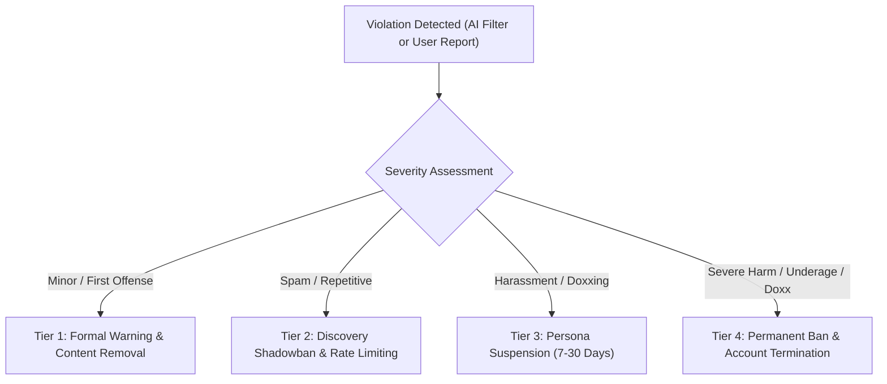

# AFTR Community Guidelines — Standards of Mutual Respect & Safety

> **Core Mission**: AFTR (*"Meet without revealing"*) provides a safe, pseudonymous space for adult campus communities (18+) to share authentic thoughts, meet new people, and explore connections without fear of judgment, surveillance, or social retaliation.
> 
> To protect the community, every member agrees to uphold these standards upon entering the platform.

---

## 1. The Five AFTR Pillars

### Pillar 1: Anonymity Integrity
- **Protect Everyone's Pseudonym**: Never attempt to de-anonymize, correlate, or expose another member's real name, campus room, phone number, social handles, or physical identity.
- **Zero Doxxing Tolerance**: Publishing someone's private information—even if you believe it is true—results in immediate, permanent platform termination.

### Pillar 2: Strict Mutual Consent
- **No Unsolicited Outreach**: Private messaging requires mutual consent. You can only chat after both personas have accepted a bilateral connection request.
- **Respect Rejection & Blocks**: If another user rejects your connection request or blocks your persona, do not create alternate personas to circumvent the block. Block evasion is an automatic permanent ban.

### Pillar 3: Adult Responsibility (18+ Exclusively)
- AFTR is an adult community. You must be at least 18 years old to hold an account.
- **Absolute Zero Tolerance for Minor Safety Violations**: Any content involving minors or attempts to solicit minors is instantly purged, reported to the National Center for Missing & Exploited Children (NCMEC), and referred to law enforcement authorities.

### Pillar 4: Non-Violence & Emotional Well-Being
- **No Threats or Intimidation**: Threats of physical violence, blackmail, extortion, or suicide/self-harm encouragement are strictly prohibited.
- **No Harassment or Hate Speech**: Slurs, hate speech targeting protected groups, and targeted smear campaigns have no place on AFTR.

### Pillar 5: Safe Public Meetups
- **Public Venues Only**: Group events and meetups must always specify recognized, open, public venues (e.g., campus library cafes, food courts, university auditoriums).
- **No Private Residential Addresses**: Never publish dorm room numbers, apartment addresses, or isolated private locations.

---

## 2. Prohibited Content Categories

| Category | Policy Details | Enforcement Action |
| :--- | :--- | :--- |
| **Doxxing & Identity Leakage** | Sharing real names, student IDs, phone numbers, email addresses, or social accounts | Immediate post removal + Permanent account ban |
| **Non-Consensual Explicit Content** | Revenge porn, intimate images without consent, non-consensual sexual discussions | Immediate removal + Account ban |
| **Credible Threats & Harassment** | Physical threats, stalking, persistent bullying, harassment of specific individuals | Immediate removal + Account suspension |
| **Commercial Spam & Scams** | Selling products, drug distribution, phishing, affiliate link farming | Automated spam purge + Quota revocation |
| **Hate Speech & Discrimination** | Dehumanizing language, slurs targeting race, gender, sexuality, or religion | Post quarantine + Persona strike |

---

## 3. Moderation & Sanction Tiers

AFTR employs an automated multi-vector safety filter paired with human moderator review:

1. **Tier 1 — Formal Warning**: Content is removed. The member receives an in-app notice specifying the violated policy.
2. **Tier 2 — Discovery Shadowban**: The persona is hidden from adult social discovery cards and feed recommendation algorithms for 14 days.
3. **Tier 3 — Persona Suspension**: The account cannot post, comment, react, or send connection requests for 7 to 30 days. Existing private chats remain accessible in read-only mode.
4. **Tier 4 — Permanent Account Termination**: Complete cascade deletion of all personas and revocation of all issued invitations. Re-registration is blocked via recipient email HMAC hashing.

---

## 4. Reporting & Appeals Process

### How to Report Content
Every post, story, meetup card, comment, and private conversation features a dedicated **Report** button (flag icon):
1. Select the violation category (Doxxing, Harassment, Inappropriate Content, Spam, Threat).
2. Add optional context.
3. Submitting a report automatically routes the content to the moderation review queue (`/admin/moderation`).
4. You will immediately be offered the option to **Block** the offending persona to prevent any further interaction.

### How to Appeal a Sanction
If you believe a sanction or content removal was issued in error:
1. Navigate to **Settings** -> **Appeals**.
2. Select the flagged item and explain why you believe the content complies with Community Guidelines.
3. A Human Security Administrator will review the appeal within 48 hours. Decisions on appeals are final.
