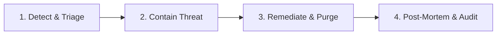

# AFTR — Incident Response Runbook & Trust & Safety Protocols

> **Audience**: Trust & Safety Engineers, Platform Administrators, On-Call Security Team  
> **Applies to**: Closed Beta (SRM Campus) and Staged Production  
> **Core Mandate**: Protect user anonymity, preserve physical and emotional safety, contain threats rapidly, and maintain transparency without exposing identity records.

---

## 1. Incident Severity Classification Matrix

| Severity | Definition | Response SLA | Primary Actions |
| :--- | :--- | :--- | :--- |
| **SEV-1 (Critical)** | Real identity leakage, bypass of moderation/admin MFA, remote code execution, database compromise, mass underage breach | **< 15 minutes** | Trigger emergency killswitches, freeze affected endpoints, page all leads, notify security administrator |
| **SEV-2 (High)** | Coordinated doxxing outbreak, credible violence/physical threat, token brute-force flood, widespread harassment | **< 30 minutes** | Activate automated text lockdown, quarantine content, suspend offender personas, initiate log forensics |
| **SEV-3 (Medium)** | Isolated spam wave, single report appeal escalation, localized rate limiter false-positives, non-critical feed glitch | **< 2 hours** | Assign to on-duty moderator, adjust content moderation keywords, process appeals |
| **SEV-4 (Low)** | Minor cosmetic UI defect, edge-case invitation error, feature suggestion | Next business day | Log ticket in GitHub issue tracker |

---

## 2. Incident Response Lifecycle



### Phase 1: Detection & Triage
- Alerts arrive via PagerDuty (Sentry error spikes, Redis rate-limiter anomaly alerts, or Trust & Safety queue surges).
- The On-Call Lead verifies severity level and posts in `#incident-war-room`.

### Phase 2: Containment
- Restrict blast radius immediately using pre-configured administrative flags and environment killswitches.
- Block originating IP subnets or revoke compromised invitation batches.

### Phase 3: Remediation & Verification
- Purge offending content from database and cache.
- Ensure automated database cascade deletes cleanly remove orphaned reactions, reports, or comments.
- Run regression tests (`pytest -v backend/tests/test_security_review.py`) to confirm patch effectiveness.

### Phase 4: Post-Mortem & Audit
- Document timeline, root cause, and remediation steps in `docs/postmortems/YYYY-MM-DD-incident-title.md`.
- No user PII or unhashed emails may ever appear in post-mortem documents.

---

## 3. Standard Operating Procedures (SOPs)

### SOP-1: Doxxing & Real-Identity Leakage Outbreak
**Trigger**: A post, story, or comment appears containing a student's real name, private phone number, home address, or social media handle without consent.

1. **Immediate Quarantine**:
   - Moderator logs into `/admin` with MFA TOTP.
   - Navigate to **Content Moderation** -> Locate flagged item -> Select **Remove Content**.
   - This sets `post.status = ContentStatus.REMOVED`, instantly excluding it from all public queries and cache.
2. **Author Persona Suspension**:
   - Click **Sanction User** on the offending persona.
   - Select `RestrictionType.SUSPENDED` with reason `DOXXING_VIOLATION`.
   - Duration: Minimum 7 days or permanent ban pending security admin review.
3. **Regex Hardening**:
   - If novel phone or campus ID patterns were used, update regex rules in [`backend/app/services/content_moderation_engine.py`](../backend/app/services/content_moderation_engine.py).
4. **Cache Invalidation**:
   - Flush related feeds in Redis:
     ```bash
     redis-cli -u $REDIS_URL DEL "feed:recent:*"
     redis-cli -u $REDIS_URL DEL "feed:trending:*"
     ```

### SOP-2: Credential Stuffing & Invitation Brute-Force Attack
**Trigger**: Redis rate limiter reports high volume of `429 Too Many Requests` on `/api/v1/invitations/validate` or `/api/v1/auth/login`.

1. **Edge Firewall Restriction**:
   - Deploy IP rate limiting at Vercel / Cloudflare edge:
     - Rate: 10 requests / minute per IP on `/api/v1/invitations/*`.
2. **Temporary Invitation Salt Rotation**:
   - If unredeemed invitation hashes are suspected of being scraped, trigger emergency revocation of pending invitations:
     ```sql
     UPDATE invitations 
     SET status = 'REVOKED' 
     WHERE status = 'PENDING' AND created_at > NOW() - INTERVAL '72 hours';
     ```
3. **Verify Zero Token Plaintext**:
   - Confirm in logs that no raw invitation tokens or email addresses were written to logs.

### SOP-3: Credible Threat of Physical Harm / Imminent Violence
**Trigger**: A user posts an imminent threat to an individual or campus location.

1. **Zero-Delay Removal**:
   - Moderator selects **Permanent Removal** (`ContentStatus.REMOVED`).
2. **Preserve Forensic Hash**:
   - Content Moderation Audit Log maintains timestamp, hashed persona ID, and violation vector (`THREAT_OF_VIOLENCE`).
   - Plaintext is purged from the public feed immediately.
3. **Emergency Escalation**:
   - Alert Security Administrator.
   - If law enforcement presents a legally verified subpoena or court order, follow the **Legal Subpoena Protocol** in [`docs/PRIVACY.md`](PRIVACY.md) to query salted infrastructure logs.

### SOP-4: Underage (< 18) Account Discovery
**Trigger**: A user reports an account as belonging to a minor, or age assurance logs indicate fraudulent attestation.

1. **Immediate Account Revocation**:
   - Security Administrator navigates to `/admin` -> **User Restrictions**.
   - Execute account termination. This triggers cascade deletion of all personas, posts, stories, and connection requests associated with the account.
2. **Quota Invalidation**:
   - All unused invitations issued by the underage account are atomically marked `REVOKED`.

---

## 4. Emergency Killswitches

The application supports immediate runtime killswitches controllable via Redis or environment variables:

| Killswitch | Setting / Key | Effect |
| :--- | :--- | :--- |
| **Halt All Invitations** | Redis key: `killswitch:invitations = "1"` | `/invitations/claim` and `/redeem` immediately return `503 Service Unavailable` |
| **Enforce Pre-Moderation** | Redis key: `killswitch:premod_all = "1"` | Every new post and story is automatically routed to `PENDING_REVIEW` queue |
| **Disable Discovery** | Redis key: `killswitch:discovery = "1"` | `/discovery/profiles` returns empty results; prevents new connection requests |
| **Realtime Chat Disconnect** | Redis key: `killswitch:chat_ws = "1"` | Closes all active WebSocket connections and forces clients to poll or sleep |

---

## 5. Post-Incident Review Checklist

- [ ] Has the offending content been completely purged from both PostgreSQL and Redis cache?
- [ ] Have all cascade relationships (comments, likes, reports) been cleanly settled?
- [ ] Was any raw PII (emails, real names, passwords, unhashed tokens) written to server logs during the incident?
- [ ] Have automated tests been written in `backend/tests/` to prevent recurrence of the specific attack vector?
- [ ] Has the post-mortem report been filed with zero PII exposure?
