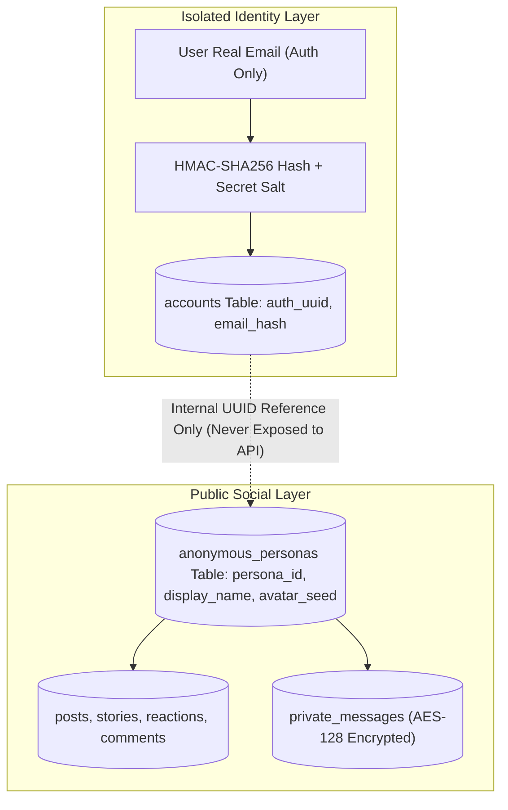

# AFTR — Privacy Architecture & Data Protection Charter

> **Tagline**: *"Meet without revealing."*  
> **Philosophy**: Pseudonymity is not a feature; it is the fundamental architectural foundation of AFTR. Users must be able to explore adult social connections and campus conversations without the threat of social exposure, surveillance, or institutional retribution.

---

## 1. The Core Privacy Tenets

1. **No Mandatory Institutional Identity**: AFTR never requires or coerces a `.edu` or college email address. Any valid standard email (e.g., Gmail, Proton, iCloud) is accepted for account verification. Campus affiliation is strictly self-declared and optional.
2. **Cryptographic Identity Decoupling**: The real authentication account (`accounts` table) is completely segregated from public-facing anonymous personas (`anonymous_personas` table).
3. **Zero PII Exposure in API Contracts**: Under no circumstances does any social endpoint return an `account_id`, `email`, `supabase_user_id`, or IP address.
4. **Ephemerality by Design**: Ephemeral content (24-hour stories, 72-hour single-use invitations) hard-expires and is automatically purged.
5. **Zero Message Logging**: Direct messages are encrypted at rest using Fernet AES-128 encryption. Message plaintext is never written to application logs, metrics, or telemetry.
6. **No Precise Geolocation**: Live GPS sharing, exact coordinates, and private residential addresses are architecturally barred from the platform. Only named public campus landmarks are permitted for meetups.

---

## 2. Cryptographic Architecture & Data Flow

### 2.1 The Identity Vault Boundary
The database schema enforces a strict boundary between identity and expression:
- **`accounts`**: Stores `id` (UUID), `supabase_user_id`, salted `email_hash`, age verification attestation timestamp, and remaining invite quota. This table is inaccessible from any public API endpoint.
- **`anonymous_personas`**: Stores `id` (UUID), `display_name` (e.g., *"Nocturnal Owl"*, *"Velvet Shadow"*), `avatar_seed`, optional `campus_affiliation`, and bio.
- **The Decoupling Guarantee**: Social queries (e.g., `GET /api/v1/feed`, `GET /api/v1/stories`, `GET /api/v1/discovery`) join exclusively against `anonymous_personas`. No API route joins `accounts` in its serialization schemas.

### 2.2 Invitation Recipient Binding via Salted HMAC
To prevent invite harvesting and public token scraping:
- When a user issues an invitation for a friend's email `user@example.com`, the server calculates:
  $$\text{recipient\_hash} = \text{HMAC-SHA256}(\text{normalized\_email}, \text{INVITATION\_SALT})$$
- Only the `recipient_hash` and the bcrypt/SHA-256 hash of the single-use token are saved in the `invitations` table.
- Plaintext recipient emails and unhashed tokens are never persisted to disk.

---

## 3. Data Protection Across Key Features

### 3.1 Private Messaging Encryption
- **At Rest**: Messages stored in `messages.encrypted_content` are encrypted using authenticated 128-bit AES encryption in CBC mode with HMAC-SHA256 authentication (Fernet specification).
- **Transport**: All WebSocket and HTTPS connections enforce TLS 1.3 with forward secrecy.
- **In-Memory Hygiene**: Decryption happens strictly in-memory during response serialization for authenticated conversation participants.
- **Zero Logging Policy**: FastAPI logger formatters explicitly exclude request and response bodies on `/chats/*` endpoints.

### 3.2 Ephemeral Story Destruction
- Stories published to `/api/v1/stories` carry an immutable `expires_at` timestamp set to `created_at + 24 hours`.
- Database index `idx_stories_expires_at` accelerates automatic filtering. Expired stories are excluded from all feed queries and purged asynchronously by the scheduled maintenance worker.

### 3.3 Location & Physical Safety
- Meetups and events require a named public venue (e.g., *"SRM Tech Park Ground Floor"*, *"Main Campus Library Cafe"*).
- The `VenueSafetyValidator` verifies:
  1. No GPS coordinates (latitude/longitude coordinates are rejected with `422 Unprocessable Entity`).
  2. No room numbers, hostel room codes, or private residential addresses.
  3. No live location tracking.

---

## 4. User Rights & Account Deletion

### 4.1 Right to Erasure ("Self-Destruct")
AFTR provides immediate, unconditional account deletion (`DELETE /api/v1/auth/account`):
1. **Immediate Session Invalidation**: The user's active session and refresh tokens are immediately revoked.
2. **Cascade Erasure**: All associated anonymous personas, active stories, unsent/pending connection requests, and unused invitations are permanently deleted from PostgreSQL via database cascade constraints (`ON DELETE CASCADE`).
3. **Unredeemed Invitation Neutralization**: All invitations issued by the departing account are atomically marked `REVOKED` so they cannot be used to introduce new accounts.
4. **Historical Feed Anonymization**: Completed post content is disassociated from active identity structures or removed according to the user's explicit preference during deletion.

---

## 5. Realistic Anonymity Disclaimers & Legal Compliance

In compliance with AFTR Product Policy Rule 13, **we never promise "absolute untraceability" or "bulletproof anonymity"**:
- **ISP and Network Level**: Students accessing AFTR via university-managed Wi-Fi networks must be aware that network administrators can observe connections to the AFTR domain (`*.aftr.app`), even though TLS 1.3 encrypts all path, query, and payload data.
- **Law Enforcement & Subpoenas**: AFTR will comply with valid court-ordered subpoenas, search warrants, or mandatory reporting requirements concerning Child Sexual Abuse Material (CSAM), human trafficking, or credible threats of imminent physical violence.
- **What We Can and Cannot Disclose**: Because AFTR does not log IP addresses, message plaintext, or unhashed email bindings, we cannot disclose information we do not possess.
